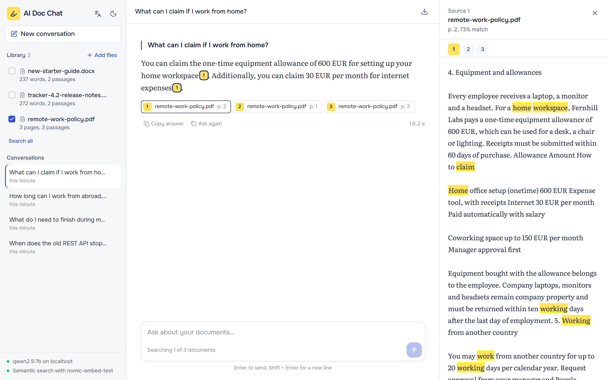
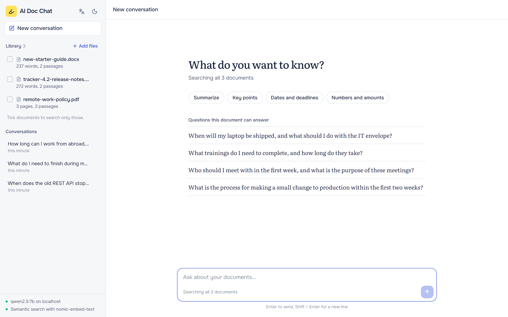
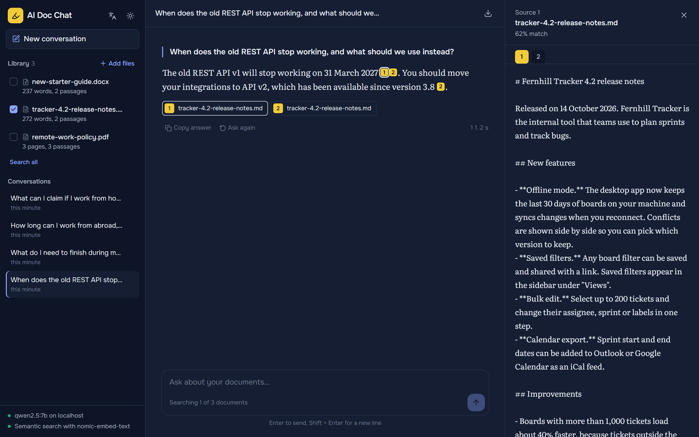
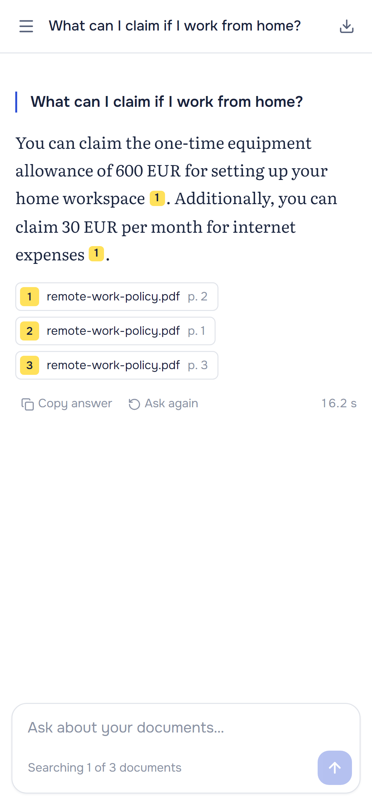
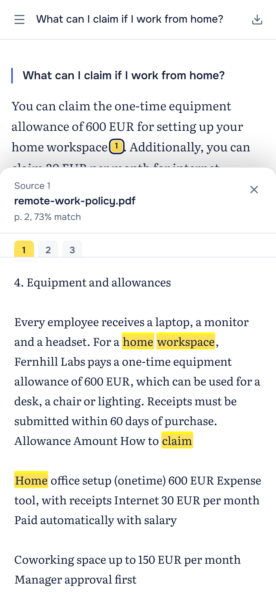

# AI Doc Chat

[](https://github.com/GrantTotinov/AiChatRagSystem/actions/workflows/ci.yml)
[](LICENSE)

A small app for asking questions about your own documents. You drop in PDFs, Word files or notes, ask something in plain language, and the answer comes back with numbered citations. Click a number and the passage it came from opens next to the answer, with the words from your question highlighted, so you can check it yourself instead of taking the model's word for it.

The backend is ASP.NET Core on .NET 10 and the frontend is React with Vite. It can run completely offline with Ollama, or use Groq (or any other OpenAI-compatible API) for the answers.



<sub>All screenshots are from a local run: qwen2.5:7b and nomic-embed-text in Ollama, CPU only, which is why answers take 10 to 20 seconds. A hosted model is a lot quicker.</sub>

## What it does

- Answers stream in as they are written and cite their sources as [1], [2]. For PDFs the citation includes the page.
- Search mixes keyword matching (BM25) with embeddings. Keywords catch exact things like ticket numbers, dates and names, and embeddings catch questions that are worded differently from the document.
- Conversations are saved and follow-up questions keep their context. You can stop an answer halfway, ask again, copy it, or export the whole conversation to Markdown.
- Ticking documents in the sidebar limits the search to those.
- It reads PDF, Word (.docx), Markdown, CSV, JSON and plain text. Every upload goes through [UploadGuard](https://github.com/GrantTotinov/UploadGuard) first, so a renamed executable or a zip bomb posing as a .docx is rejected before anything tries to parse it.
- If Ollama isn't running, search falls back to keywords only. With no language model set up you still get the best matching passages, just not a written answer.
- Light and dark theme, English and Bulgarian, and the layout works on a phone.

A new conversation offers a few questions the newest document can answer. The dark one below is limited to the release notes.

<p>
  
  
</p>

On a phone, the source slides up from the bottom.

<p align="center">
  
  &nbsp;&nbsp;
  
</p>

## Running it

You need the [.NET 10 SDK](https://dotnet.microsoft.com/download), [Node.js](https://nodejs.org) 20.19 or newer, and [Ollama](https://ollama.com) for the embeddings.

```bash
ollama pull nomic-embed-text
```

No Ollama on the machine? `docker run -d -p 11434:11434 -v ollama:/root/.ollama --name ollama ollama/ollama` followed by `docker exec ollama ollama pull nomic-embed-text` gets you the same thing.

Then decide where the answers come from. Keys go into [user secrets](https://learn.microsoft.com/aspnet/core/security/app-secrets) so they never end up in the repo.

```bash
cd AiDocChat.Api

# Groq has a free tier: https://console.groq.com/keys
dotnet user-secrets set "Llm:ApiKey" "gsk_..."

# or keep everything local
ollama pull qwen2.5:7b
dotnet user-secrets set "Llm:BaseUrl" "http://localhost:11434/v1"
dotnet user-secrets set "Llm:Model" "qwen2.5:7b"
```

Build the UI into the API's `wwwroot` and start the API:

```bash
cd frontend
npm install
npm run build

cd ../AiDocChat.Api
dotnet run
```

The app is now on http://localhost:5261. The [`samples`](samples) folder has a PDF, a Word file and a Markdown file to try it with.

For work on the UI, leave `dotnet run` going and run `npm run dev` in `frontend/`. Vite serves on port 5173 with hot reload and forwards `/api` to the backend.

## How it works

When a file comes in, the text is pulled out page by page (PdfPig for PDFs; Word files are read straight from their XML) and split into chunks of about 220 words. A chunk always ends at the end of a sentence, overlaps the previous one by about 40 words, and never spans two PDF pages, which is how citations get an exact page number. The chunks are embedded with nomic-embed-text through Ollama and stored in SQLite as float32 blobs.

A question is ranked against the selected documents twice, once with BM25 and once by cosine similarity, and the two rankings are merged with reciprocal rank fusion. Passages that share no words with the question and score well below the best match are thrown out. For a follow-up, the previous question is searched along with it, so "and the internet?" still lands in the right section. The top six passages go to the model, numbered, with instructions to answer only from them and to cite them. The reply streams back to the browser as server-sent events.

Vector search is a plain loop over an in-memory cache. That is plenty for a personal library; somewhere past 100k chunks it would be worth moving to sqlite-vec or a proper vector store.

## Settings

Everything lives in [`appsettings.json`](AiDocChat.Api/appsettings.json) and can be overridden with user secrets or environment variables (`Llm__ApiKey`, `Rag__TopK` and so on). A `GROQ_API_KEY` variable works too.

| Setting | Default | Notes |
|---|---|---|
| `Llm:BaseUrl` | `https://api.groq.com/openai/v1` | Any OpenAI-compatible endpoint. Ollama is `http://localhost:11434/v1` |
| `Llm:Model` | `openai/gpt-oss-20b` | |
| `Llm:ApiKey` | | Not needed for a local endpoint |
| `Embeddings:Model` | `nomic-embed-text` | See the note on languages below |
| `Embeddings:DocumentPrefix` / `QueryPrefix` | `search_document: ` / `search_query: ` | The prefixes nomic-embed-text was trained with. Clear them for other models |
| `Rag:TopK` | `6` | Passages sent to the model per question |
| `Rag:ChunkWords` / `OverlapWords` | `220` / `40` | |
| `Rag:HistoryMessages` | `6` | Earlier messages sent along with a follow-up |
| `Rag:MaxUploadBytes` | `26214400` | 25 MB per file |

Changing the embedding model only applies to files added after the change. Re-upload older ones to re-embed them.

## API

There is an OpenAPI document at `/openapi/v1.json` and a browsable version at `/scalar` when running in Development. [`AiDocChat.Api.http`](AiDocChat.Api/AiDocChat.Api.http) has a few ready-made requests.

| Method | Path | Notes |
|---|---|---|
| `GET` | `/api/health` | Whether the language model and Ollama are reachable |
| `GET` `POST` | `/api/documents` | List documents, or upload (multipart field `files`) |
| `DELETE` | `/api/documents/{id}` | |
| `GET` | `/api/documents/{id}/suggestions` | Questions the document can answer |
| `POST` | `/api/chat` | Ask a question. The response is a stream of `meta`, `token` and `done` (or `error`) events |
| `GET` | `/api/conversations`, `/api/conversations/{id}` | |
| `DELETE` | `/api/conversations/{id}` | |

## Things to know

- nomic-embed-text is an English model. Asking in Bulgarian about English documents, or the other way round, finds noticeably worse passages. `bge-m3` copes with that: set it as `Embeddings:Model` and clear both prefixes.
- Small local models (I tried qwen2.5:3b) sometimes skip citations or reply in English to a question in another language. qwen2.5:7b is much better, though even it cites the wrong passage now and then. That is what the source panel is for.
- Scanned PDFs have no text layer, so they need OCR before upload.
- There is no login. Keep it on localhost or put it behind your own auth.

## Tests

`dotnet test` covers the chunker, the ranking and Word extraction. CI runs those and lints and builds the frontend on every push.

## License

[MIT](LICENSE)
