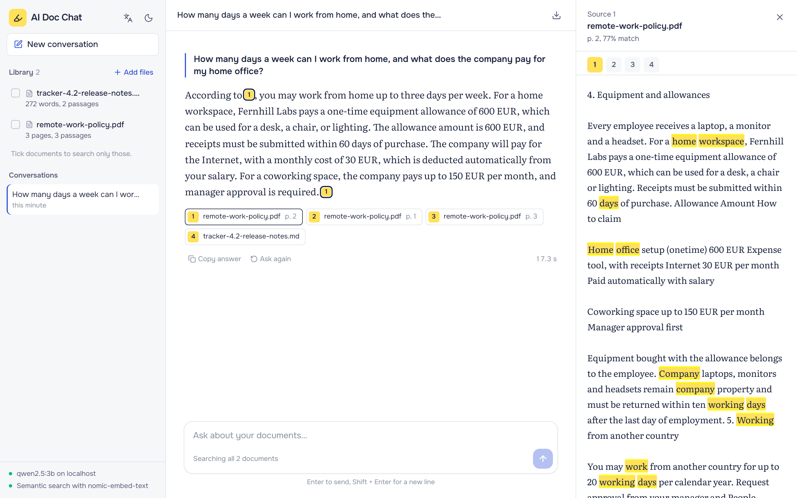
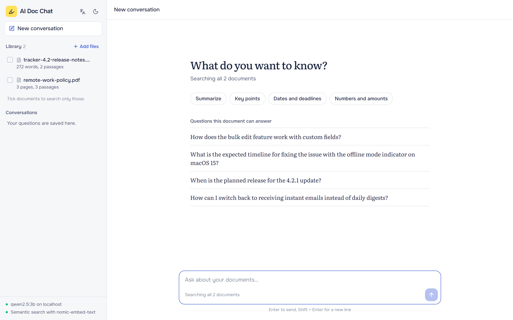
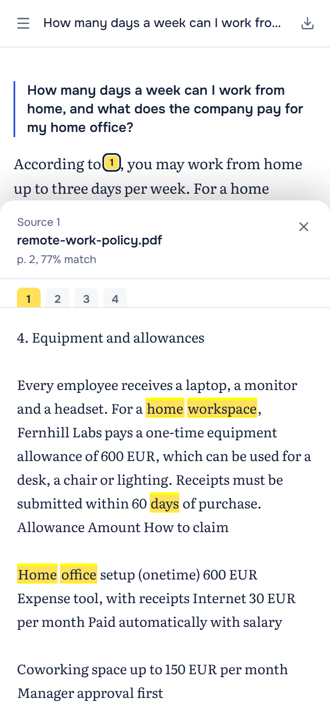
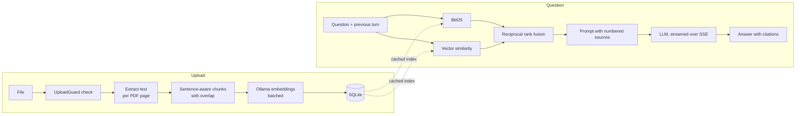

# AI Doc Chat

[](https://github.com/GrantTotinov/AiChatRagSystem/actions/workflows/ci.yml)


[](LICENSE)

**Ask questions about your own documents and get answers that cite the exact passage they came from.**
Upload PDFs, Word files, Markdown, CSV or text, then chat with them. Every claim in an answer has a numbered mark; click it and the source passage opens beside the answer with your search terms highlighted.

It runs fully on your machine with [Ollama](https://ollama.com), or with any OpenAI-compatible API such as [Groq](https://console.groq.com) for the answers.



## Features

- **Answers with citations.** Answers stream in token by token and cite sources as `[1]`, `[2]`. Each source shows the file, the PDF page and how closely it matched.
- **Hybrid search.** BM25 keyword ranking and embedding similarity are merged with reciprocal rank fusion, so exact names, codes and numbers are found as reliably as paraphrases.
- **Conversations.** Chats are saved, follow-up questions keep their context, and you can stop an answer, ask again, copy it or export the conversation as Markdown.
- **Choose what to search.** Tick documents in the library to limit a conversation to them, or search everything.
- **Summaries and suggestions.** One click for a summary, key points, dates or amounts. The app also suggests questions each document can answer.
- **Formats.** PDF (page-accurate citations), Word `.docx`, `.txt`, Markdown, CSV and JSON, up to 25 MB each, by drag and drop.
- **Safe uploads.** Every file is checked with [UploadGuard](https://github.com/GrantTotinov/UploadGuard): the real type is detected from the bytes, and zip bombs, macros and PDF JavaScript are rejected. Duplicate files are recognised by their SHA-256 hash.
- **Works when parts are missing.** Without Ollama it falls back to keyword search; without a language model it answers with the best matching passages.
- **Interface.** Light and dark themes, English and Bulgarian, keyboard friendly, and a layout that works on phones.

| Suggested questions | Dark theme, one document in scope | Phone |
|---|---|---|
|  |  |  |

## How it works



1. **Ingest.** Text is extracted with [PdfPig](https://github.com/UglyToad/PdfPig) (one entry per page) or read from the Word XML directly. It is split into chunks of about 220 words that end on sentence boundaries and overlap by 40 words; chunks never cross a PDF page, so citations always have an exact page.
2. **Embed.** Chunks are embedded with `nomic-embed-text` through Ollama's batch endpoint, using the model's `search_document:` and `search_query:` prefixes. Vectors are normalised and stored as float32 BLOBs, so similarity is a plain dot product.
3. **Retrieve.** For each question the cached index of the selected documents is ranked twice, by BM25 and by vector similarity, and the two rankings are fused. Passages that share no keyword with the question and are much less similar than the best match are dropped.
4. **Answer.** The top passages are numbered and sent with the conversation history to the model, which is told to answer only from them and cite them. Tokens are streamed to the browser as server-sent events. Stopping keeps the partial answer.

## Quick start

You need the [.NET 10 SDK](https://dotnet.microsoft.com/download) and [Node.js 20.19+](https://nodejs.org).

### 1. Embeddings (Ollama)

```bash
ollama pull nomic-embed-text
```

No Ollama? Run it in Docker: `docker run -d -p 11434:11434 -v ollama:/root/.ollama --name ollama ollama/ollama`, then `docker exec ollama ollama pull nomic-embed-text`. The app still works without it, using keyword search only.

### 2. A language model, local or hosted

Pick one and set it with [user secrets](https://learn.microsoft.com/aspnet/core/security/app-secrets), which stay out of the repository:

```bash
cd AiDocChat.Api

# Groq (free key from https://console.groq.com/keys), default model openai/gpt-oss-20b
dotnet user-secrets set "Llm:ApiKey" "gsk_..."

# or fully local with Ollama
ollama pull qwen2.5:7b
dotnet user-secrets set "Llm:BaseUrl" "http://localhost:11434/v1"
dotnet user-secrets set "Llm:Model" "qwen2.5:7b"
```

### 3. Run

```bash
cd frontend
npm install
npm run build          # writes the app to AiDocChat.Api/wwwroot

cd ../AiDocChat.Api
dotnet run             # http://localhost:5261
```

Try it with the files in [`samples/`](samples). For frontend work, keep `dotnet run` going and start `npm run dev` in `frontend/`: Vite serves http://localhost:5173 with hot reload and proxies `/api` to the API.

## Configuration

Settings live in [`appsettings.json`](AiDocChat.Api/appsettings.json) and can be overridden with user secrets or environment variables (`Llm__ApiKey`, `Rag__TopK`, ...). `GROQ_API_KEY` and the old `Groq:ApiKey` also work.

| Setting | Default | Meaning |
|---|---|---|
| `Llm:BaseUrl` | `https://api.groq.com/openai/v1` | Any OpenAI-compatible endpoint: Groq, OpenAI, OpenRouter, Ollama (`http://localhost:11434/v1`) |
| `Llm:Model` | `openai/gpt-oss-20b` | Chat model name at that endpoint |
| `Llm:ApiKey` | empty | Not needed for a local endpoint |
| `Embeddings:Model` | `nomic-embed-text` | Ollama embedding model. For questions in one language about documents in another, use `bge-m3` and clear both prefixes |
| `Embeddings:DocumentPrefix`, `QueryPrefix` | `search_document: `, `search_query: ` | Task prefixes the nomic model was trained with |
| `Rag:TopK` | `6` | Passages sent to the model per question |
| `Rag:ChunkWords`, `Rag:OverlapWords` | `220`, `40` | Chunk size and overlap |
| `Rag:HistoryMessages` | `6` | Earlier messages included for follow-up questions |
| `Rag:MaxUploadBytes` | `26214400` | Upload limit per file (25 MB) |

Changing the embedding model only affects files added afterwards; re-add older files to re-embed them.

## API

The OpenAPI document is at `/openapi/v1.json` and an interactive reference at `/scalar` in development. [`AiDocChat.Api.http`](AiDocChat.Api/AiDocChat.Api.http) has ready-made requests.

| Method | Path | Purpose |
|---|---|---|
| `GET` | `/api/health` | Language model and embedding status |
| `GET` | `/api/documents` | List documents |
| `POST` | `/api/documents` | Upload files (multipart `files`) |
| `DELETE` | `/api/documents/{id}` | Delete a document and its chunks |
| `GET` | `/api/documents/{id}/suggestions` | Questions the document can answer |
| `POST` | `/api/chat` | Ask a question; streams `meta`, `token`, `done` or `error` events |
| `GET` | `/api/conversations` | List conversations |
| `GET` | `/api/conversations/{id}` | A conversation with its messages and sources |
| `DELETE` | `/api/conversations/{id}` | Delete a conversation |

```json
POST /api/chat
{ "question": "What does the company pay for a home office?", "conversationId": null, "documentIds": [], "overview": false }
```

## Project structure

```
AiDocChat.Api/          ASP.NET Core 10 minimal API
  Program.cs            Configuration and endpoints
  Services/             TextExtractor, TextChunker, EmbeddingClient, Retriever, LlmClient, ChatService, DocumentService
  Data/, Models/        EF Core SQLite context and entities
AiDocChat.Tests/        xUnit tests for chunking, ranking and Word extraction
frontend/               React 19, TypeScript, Tailwind CSS 4, Vite
samples/                Example documents to try
```

## Security notes

- Uploads are validated by content, not by extension, before any parsing. XML in Word files is read with DTD processing disabled.
- Document text is passed to the model as data, and the system prompt tells it to ignore instructions inside sources. Treat answers about untrusted documents with the usual care around prompt injection.
- Question and suggestion endpoints are rate limited (30 requests per minute).
- There is no authentication: run it locally or put it behind your own sign-in before exposing it.

## Development

```bash
dotnet test                         # backend tests
cd frontend && npm run lint         # ESLint
```

## License

[MIT](LICENSE) © Grant Totinov
